## 🧑‍💻 About Me

- 🔭 Full-stack developer at **COAF** (Children of Armenia Fund), based in **Armenia**
- ⚙️ I build with **Node.js / Express.js**, **React / Vite / Next.js**, **MongoDB** and REST APIs. Then I **deploy and run the infrastructure myself**: Linux VPS, Nginx, PM2, SSL and monitoring
- 🎨 I also design, with **Figma** and the **Adobe** suite
- 📫 Reach me on [LinkedIn](https://linkedin.com/in/dstepanian)

## 🌐 Socials

&nbsp;
&nbsp;

# 💻 Tech Stack

> Full-stack developer focused on Node.js / Express.js backends, React / Vite / Next.js frontends, real-time systems and production deployment, with an eye for design and full ownership of the infrastructure.

**Languages**  

**Backend**  

**Frontend**  

**Databases**  

**Infrastructure & monitoring**  

**Hardware & IoT**  

**Tools**  

**Design**  

**Also:** Socket.io and WebRTC for real-time, GSAP for animation, PM2 for process management, WireGuard and Ubiquiti networking, Telegram bots

# 📊 GitHub Stats

 

